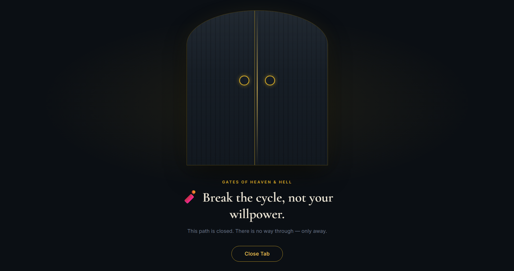

# Gates Of Heaven & Hell



A Manifest V3 Chrome extension version of the original Tampermonkey blocker —
rebuilt on `declarativeNetRequest` instead of polling/click-interception, with
a no-bypass blocked page, and lockable/friction-gated rule removal.

## Install (unpacked)

1. Put your real rules into `bookOfLinks.jsonc` at the root of this folder —
   same `["domain", "substring"]` array format you already use. It's only
   read **once**, on first install, to seed the extension.
2. Go to `chrome://extensions`.
3. Turn on **Developer mode** (top right).
4. Click **Load unpacked** and select this folder
   (`Gates Of Heaven & Hell`).
5. Click the extension's toolbar icon any time to open the **Rule Book**
   (options page) and manage rules from then on.

## Structure

```
Gates Of Heaven & Hell/
├── manifest.json            MV3 manifest ("incognito": "split")
├── bookOfLinks.jsonc         First-install seed file (your rules)
├── pages/
│   ├── blocked.html         The no-bypass blocked page
│   └── options.html         The Rule Book UI
├── styles/
│   ├── blocked.css          Blocked page styling & gate animation
│   └── options.css          Rule Book dark parchment UI styling
├── scripts/
│   ├── background.js        Service worker (seeds storage, DNR compilation, alarms)
│   ├── rules-engine.js      Shared matching + regex-compiler logic
│   ├── content-youtube.js   Content script catching YouTube search form
│   ├── blocked.js           Blocked page interactions & tab closer
│   └── options.js           Rule Book UI controller (add/edit/remove/lock)
├── icons/                   Toolbar & extension icons
├── .gitignore
└── README.md
```

Everything after install lives in `chrome.storage.local` — the `.jsonc` file
is not read again unless you use **Import** on the options page.

## How it works, in short

- **Blocking**: `declarativeNetRequest` matches your BLOCKED rules (compiled
  to regex under the hood — you never touch regex) and redirects the
  top-level page to `pages/blocked.html` carrying rule identifiers. EXCLUDED
  rules are compiled as higher-priority `allow` rules, so they always win.
- **Custom Site Messages**: When a blocked site opens `blocked.html`, it checks
  if a custom message was configured for that rule in the Rule Book. If present,
  it displays the custom message; otherwise, it displays an Islamic reminder.
- **Incognito Isolation**: Configured with `"incognito": "split"` so blocked
  pages and the Rule Book open seamlessly in private browsing windows without
  being blocked by Chrome client security policies.
- **Blocked page**: shows a message, no "proceed anyway" — one button,
  **Close Tab**, which shows a brief toast and closes the tab.
- **Pausing a BLOCKED rule**: type a reason → 30-minute cooling-off → type a
  reason again → paused. While paused, the rule is inactive and stops blocking.
  Click **Resume** anytime to re-enable blocking immediately.
- **Deleting a BLOCKED rule**: click **Delete** → deleted instantly without delay.
- **Locked rules**: hard-locked rules cannot be paused, edited, or deleted until
  their lock expires (Mon–Thu lock → unlocks Friday 6 PM, stays locked
  through the weekend; Fri/Sat/Sun lock → flat 24 hours).
- **EXCLUDED rules**: freely, instantly editable & removable — no friction.
- **YouTube search**: a content script catches the search form before submit,
  jumping straight to the blocked page without flashing the results page.
