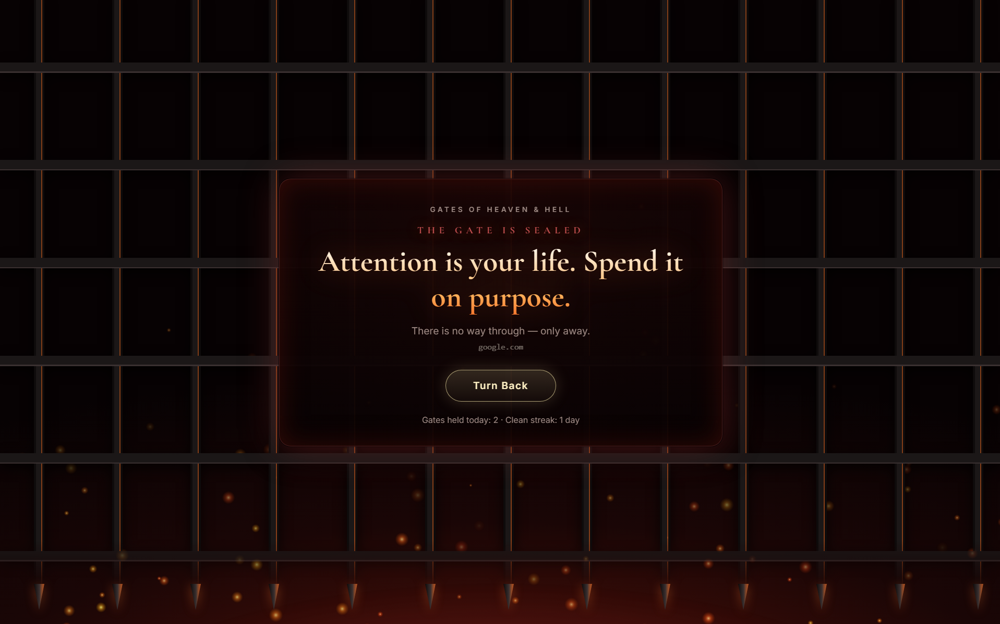
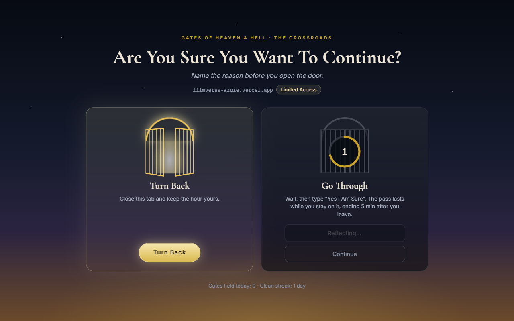
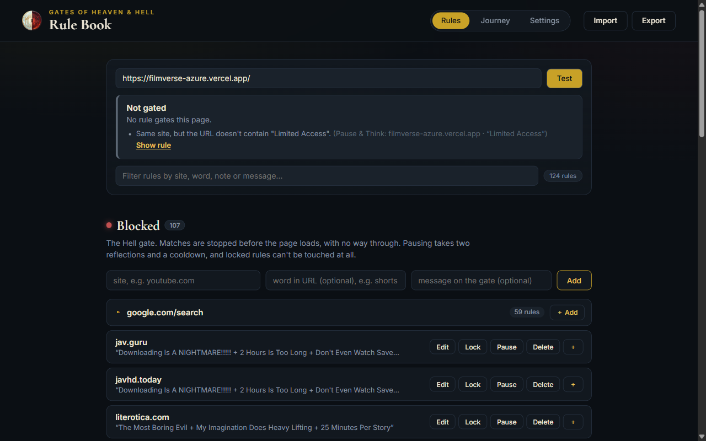
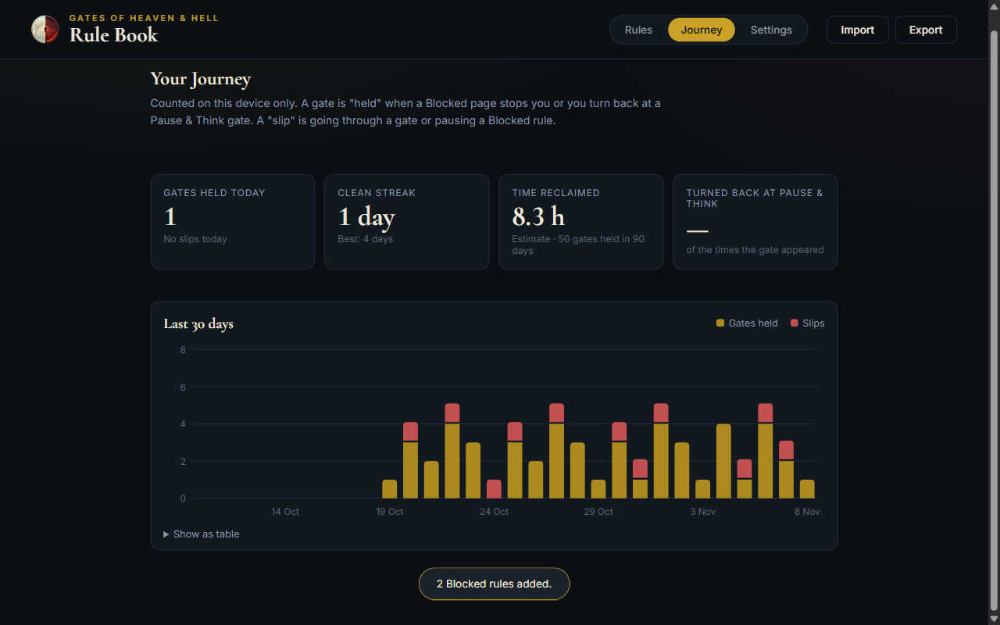
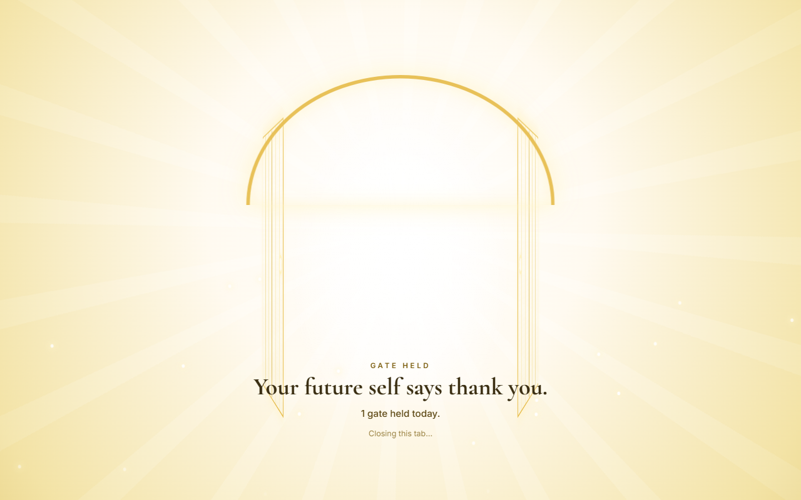
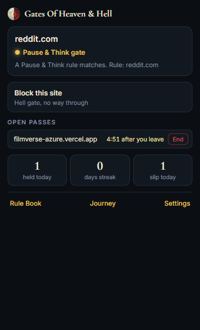

# Gates Of Heaven & Hell: A No-Bypass Website Blocker for Chrome

[](https://developer.chrome.com/docs/extensions/develop/migrate/what-is-mv3)
[](LICENSE)
[](#development)
[](#privacy)

**Gates Of Heaven & Hell is a free, open-source Chrome extension that blocks distracting and harmful websites, and is built so you can't talk yourself out of it.** Blocked sites hit a Hell gate with no "continue anyway" button. Habit sites hit a Pause & Think crossroads where you wait and type `Yes I Am Sure` before going in. Walking away opens the gates of Heaven.

It's a site blocker, distraction blocker and focus tool for people who have tried the one-click kind and know how quickly it gets switched off.

| The Hell gate (blocked sites) | The crossroads (Pause & Think) |
|---|---|
|  |  |

## Project Overview

Most website blockers fail because turning them off takes one click in a weak moment. This one puts friction where it matters:

- **Blocked sites** are stopped by Chrome itself (`declarativeNetRequest`) before the page loads, and replaced with the Hell gate. There's no bypass button, only **Turn Back**.
- **Pause & Think sites** aren't banned. You get a reflection wait (with no countdown to stare at), then type your own promise for that site (its note, or `Yes I Am Sure`) and watch the gate grind open, which turns a habit into a choice. The pass lasts while you stay on the site (or a fixed time), then open tabs go back to the gate.
- **Links opened in a new tab** to a blocked site close instantly instead of showing the gate.
- **Turning a block off** means writing why, waiting through a cooldown (30 minutes by default) and confirming again. You choose how long the pause lasts and it resumes on its own. Rules can also be **locked** until Friday evening so they can't be touched at all.
- **Walking away** (the button, or just closing the tab) counts as a gate held. **Every rule keeps its own streak**, shown right on its gate, so one slip on one site doesn't wipe the rest. The Journey tab digs into a year of data.
- **Exceptions** (one useful page on a blocked site) always win.

Everything lives in Chrome's local storage on your machine. No accounts, no servers, no tracking.

## Features

- 🔥 **Hell gate for blocked sites**: blocked before the page loads, with no bypass. Custom message per rule.
- ⚖️ **Pause & Think crossroads**: a reflection wait with no visible countdown (it only runs while you're looking), an exact typed phrase, then a pass that ends when you leave the site, after a fixed time or at the end of the day.
- 😇 **Heaven gate when you walk away**: golden light, an affirmation and today's tally, then the tab closes.
- 🔒 **Hard locks**: a locked rule can't be paused, edited, deleted or wiped by an import until the lock ends.
- ⏳ **Friction-gated pausing**: two written reasons plus a cooldown. Shortening the cooldown only takes effect after the current one has passed.
- 🕘 **Schedules**: rules can be active only on chosen days and hours, including overnight windows like 22:00–06:00.
- 🧪 **URL tester**: paste a link and see whether it will be gated, by which rule, and why it isn't when it isn't.
- 🩺 **Rule health checks**: catches rules that won't do what you meant (a label typed into the substring box, duplicates, rules an exception always overrides) with one-click fixes.
- ➕ **Quick add**: add many words to an existing site (like `google.com/search`) at once, comma-separated.
- 🧭 **Toolbar popup**: this page's status, "Block" or "Pause & Think" for the whole site or just part of it (one YouTube channel, one subreddit), live pass timers with **End pass**.
- 📈 **Journey dashboard**: per-rule streaks in a sortable table, a year calendar, a weekday × hour heatmap of when gates hit, the Pause & Think funnel, time spent on passes and week-over-week change. Today's slips stay hidden so one slip doesn't snowball. Clear the last hour, today or all time when you need a fresh start.
- ⏱️ **Per-site timings**: any rule can have its own wait, pass length or (for Blocked rules) pause cooldown.
- 🔍 **Search engine aware**: Google search rules match only your search text, not Google's tracking parameters, and only at the start of a word (so a short word can't fire inside "object"). YouTube searches are caught before the results page flashes.
- 🧩 **Single-page apps covered**: in-app navigation (Reddit, YouTube, X) is gated too, not just full page loads.
- 🔊 **Gate sounds**: the portcullis slams, the iron gate grinds open, Heaven sings when you walk away. Synthesized in the browser (no audio files) and can be turned off in Settings.
- 🌍 **Universal or faith-based reminders**: reflective lines for anyone by default, or Islamic reminders if you prefer.
- 🕶️ **Incognito support** with split mode, and **JSONC import/export** for backups.

## Screenshots

| Rule Book with the URL tester | Journey dashboard |
|---|---|
|  |  |

| Walking away | Toolbar popup |
|---|---|
|  |  |

## Install

Not on the Chrome Web Store yet, so load it unpacked:

1. Download or clone this repository.
2. *(Optional)* Put your rules in `bookOfLinks.jsonc` at the repo root (format below). It's read once, on first install.
3. Open `chrome://extensions` and turn on **Developer mode**.
4. Click **Load unpacked** and pick the repo folder.
5. Pin the extension and click its icon for the popup, or open the **Rule Book** from there.

Built and tested in Chrome. Other Chromium browsers with Manifest V3 support (Edge, Brave) should work the same way.

## Writing rules

Each rule is a **site** plus an optional **word in the URL**:

| Site | Word | Gates |
|---|---|---|
| `reddit.com` | | all of reddit.com and its subdomains |
| `youtube.com` | `shorts` | YouTube URLs containing "shorts" |
| `google.com/search` | `casino` | Google searches whose text contains "casino" |
| `*` | `casino` | any site whose URL contains "casino" |

Sites match exactly or as a parent domain, so `x.com` never catches `dropbox.com`. Spaces in a word match `+`, `%20` or a space.

Priority, highest first: **Exceptions** › open passes › **Pause & Think** › **Blocked**.

### Import / export format (JSONC)

```jsonc
{
  "BLOCKED": [
    ["youtube.com", "shorts", "Not today."],          // site, word, message
    ["reddit.com"]
  ],
  "PAUSE_AND_THINK": [
    ["linkedin.com", "", "Job search only"],          // site, word, note
    { "domain": "x.com", "passMode": "fixed", "passMinutes": 10,
      "schedule": { "days": [1, 2, 3, 4, 5], "start": "09:00", "end": "17:00" } }
  ],
  "EXCLUDED": [
    ["youtube.com/results", "recipe"]
  ]
}
```

Old array-only files import unchanged. Importing never removes a locked rule.

## How it compares

| | Typical blocker | Gates Of Heaven & Hell |
|---|---|---|
| Turn it off | One click | Two written reasons + cooldown, or impossible while locked |
| Blocked page | "Continue anyway" link | No way through |
| Soft limits | Rarely | Pause & Think with a timed pass |
| Rewards walking away | No | Heaven gate, streaks, 30-day chart |
| Catches in-app navigation | Often not | Yes |
| Data | Often a cloud account | Local only |

## FAQ

**Can I bypass a blocked site?**
Not from the gate. You can pause a Blocked rule, but only after two written reasons and a cooldown, and never while it's locked.

**Why isn't a site being blocked?**
Paste the URL into the **URL tester** in the Rule Book. It tells you which rule applies or why none does. A common cause is text in the "word in URL" box that never appears in the address. The rule health check flags that and offers to move it into the note.

**Does it work in incognito?**
Yes. Allow it in incognito from `chrome://extensions`. It runs in split mode, so incognito gets its own copy of the gate pages.

**Does it send my browsing anywhere?**
No. There are no network calls besides loading Google Fonts on the extension's own pages.

**Is it religious?**
No. Reminders are universal by default. A faith-based (Islamic) set is available in Settings.

## Privacy

Rules, passes, settings and stats are stored in `chrome.storage.local` on your device. Nothing is collected, synced or sent anywhere.

## Development

Plain JavaScript, HTML and CSS: no build step, no dependencies.

```
manifest.json            MV3 manifest
pages/                   blocked.html (Hell), pause.html (crossroads), options.html (Rule Book), popup.html
scripts/background.js    service worker: DNR rules, timers, passes, re-gating, stats
scripts/rules-engine.js  pure matching, schedules, URL explanations, lint, DNR regex compiler
scripts/shared.js        pure settings, timers, stats and JSONC helpers
scripts/*.js             page controllers, reminder packs, Heaven transition, synthesized sounds
styles/                  one stylesheet per page plus heaven.css
tests/                   node --test unit tests
context/                 architecture, UI tokens and progress notes
```

Check your changes:

```bash
node --test   # unit tests + syntax check of every script
```

Then reload the extension in `chrome://extensions` to try it out. See [`context/ARCHITECTURE.md`](context/ARCHITECTURE.md) for how it fits together.

## Contributing

Issues and pull requests are welcome. Please keep the no-bypass design intact: no "proceed anyway", and locked rules stay locked.

## License

[MIT](LICENSE) © 2026 Abdul Khan
